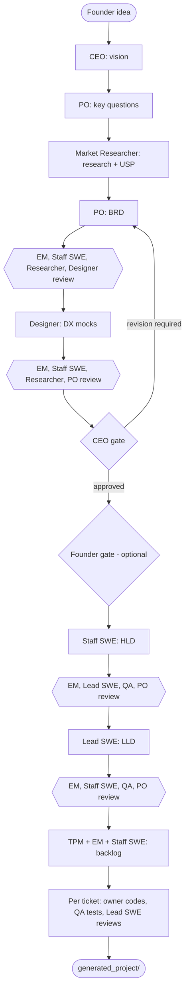

# startup-swarm

A ten-person software startup made of AI agents on Amazon Bedrock. You give it an idea;
the CEO, Product Owner, Market Researcher, Product Designer, Staff/Lead/Senior engineers,
QA, EM and TPM take it from vision to BRD, mocks, HLD, LLD, backlog and working code with
tests, with review gates between every step.

- **Runs offline first.** Mock mode exercises the whole company with no AWS account and no cost.
- **Process rules are code, not prompts.** Engineering cannot start until the CEO gate is approved.
- **Token-frugal by design.** Document hand-offs instead of chat history, scoped JSON reviews,
  bounded revisions, prompt caching, a hard token budget, and resume-after-stop.
- **Two stages.** `beta` (disposable) and `prod` (retained, point-in-time recovery), deployed with AWS CDK.

## How the company works



| # | Role | Modelled on | Owns | Default model tier |
|---|---|---|---|---|
| 1 | CEO | Amazon VP / single-threaded leader | Vision, go/no-go gate | evaluator (Haiku) |
| 2 | Staff Engineering Manager | Meta M2 / Google L7 EM | Feasibility, scoping, staffing | workhorse (Haiku) |
| 3 | Staff Product Owner | Google L6 PM / Amazon Principal PM-T | Research questions, BRD (PR/FAQ, Gherkin) | reasoner (Sonnet) |
| 4 | Staff TPM | Amazon Principal TPM | Backlog, dependencies, status | workhorse |
| 5 | Staff Market Researcher | Staff UX research / product marketing | Market position, USP | evaluator |
| 6 | Staff Software Engineer | Google L6 / Meta E6 | HLD, cross-cutting tickets | reasoner |
| 7 | Lead Software Engineer | Amazon L6 tech lead | LLD, contracts, code review | reasoner |
| 8 | Senior Software Engineer | Google L5 / Meta E5 | Implementation | workhorse |
| 9 | Staff QA / SDET | Amazon QAE III / Google L6 SDET | Tests | workhorse |
| 10 | Staff Product Designer | Meta/Apple L6 design technologist | Developer-experience mocks | reasoner |

Role definitions live in `agents/`; the shared company charter (process, review and code
rules every agent follows) is `agents/charter.py`. Models per tier are set in `config.yaml`.

## Quickstart (offline, about 5 minutes)

Requires Python 3.11+.

```bash
git clone https://github.com/pankajkumar-codes/startup-swarm.git
cd startup-swarm
python3 -m venv .venv && source .venv/bin/activate      # Windows: .venv\Scripts\activate
pip install -e ".[dev]"

python -m pytest -q                                      # 45 offline tests
startup-swarm run --mock --idea "A CLI that turns meeting notes into Jira tickets"
startup-swarm status --mock
```

Everything is written to `artifacts/beta/<project>/`: the numbered documents, `reviews/`,
`tickets/`, `generated_project/` (code + tests) and `.history/` (every version and diff).
Mock output is placeholder text; it proves the plumbing, gates and resume logic, not the
quality of real model output.

## Talking to the team

| You want to | Command |
|---|---|
| Start or continue the full company | `startup-swarm run --idea "..."` (later runs: `startup-swarm run`) |
| Give one task straight to engineering | `startup-swarm task "Add retry with backoff to the API client" --context-file src/client.py` |
| See where things stand | `startup-swarm status` (add `--json` for tools/dashboards) |
| Approve or override a gate | `startup-swarm approve-gate founder` / `startup-swarm approve-gate ceo` |
| Work on several products | add `--project <name>` to any command |

Common flags: `--stage beta|prod`, `--mock`, `--config path`, `--workspace dir`, `-v`.

**`config.yaml` is the founder brief**: default idea, reference repo, model per role,
reviewers per document, gate rules and token limits.

**Direct task mode** skips the CEO/PO/Designer: the EM scopes the task (and may reject it),
the Lead SWE writes a contract, the owner codes, QA writes tests, the Lead SWE reviews, and
one fix pass is made if needed. Use `--target-dir` to write into an existing repo folder
(paths are validated so nothing is written outside it).

## Process rules (enforced in `orchestrator/pipeline.py`)

- **Phases are checkpointed.** Re-running resumes after the last finished phase, so a crash,
  budget stop or timeout never re-pays for completed work. `run --fresh` restarts a local project.
- **Scoped reviews.** Each document is reviewed only by the roles in `process.reviewers`.
  Reviews are strict JSON; invalid JSON is retried once and then counts as a blocker (fails closed).
- **Bounded revisions.** Blockers are merged into one deduplicated punchlist and the author
  revises at most `max_review_rounds` times. With `rereview_after_revision: true`, anything still
  blocked is escalated to the CEO in `99_OPEN_ISSUES.md`.
- **CEO gate.** The CEO returns a JSON decision. `REVISION_REQUIRED` sends required changes back
  to the PO and Designer; after `max_ceo_gate_attempts` the run stops with
  `BLOCKED_ON_CEO_APPROVAL` and no architecture work starts.
- **Founder gate (optional).** `founder_approval_required: true` pauses after CEO approval until
  you run `approve-gate founder`.
- **Ticket batches.** Phase 5 builds at most `max_tickets_per_run` tickets per run, in priority
  and dependency order.

## Token controls

| Control | What it does |
|---|---|
| Artifact bus | Agents read documents, not chat history. Each call carries only what it needs. |
| Tiered models | Sonnet for synthesis (BRD/mocks/HLD/LLD), Haiku for code, tests, reviews and gates. |
| Prompt caching | Shared charter and the document under review sit in a cached prefix (Converse `cachePoint`). All reviewers of a document run on `review_tier`, so the document is cached once and read from cache by the rest. Prefixes below the model's minimum (512 tokens on Claude 5.5 models) are not cached. |
| Bounded reviews | Review output capped by `max_review_output_tokens`; one revision round by default. |
| Budget cap | `budget_cap_tokens` stops the run cleanly (`PAUSED_BUDGET`); the next run resumes. |
| Measured, not assumed | Real input, output, cache-read and cache-write tokens from Bedrock are reported per run and per agent in `usage_last_run.json` and in `status`. |

## Running against real Bedrock (beta first)

### 1. Prerequisites
- AWS account and AWS CLI credentials (`aws sts get-caller-identity` works)
- Node.js 20+ and the CDK CLI: `npm install -g aws-cdk`
- The models in `config.yaml` must be callable in your account and region. Check the Bedrock
  console (Model catalog). Anthropic models may ask for a one-time use-case form.
  Model IDs change over time; update `config.yaml` if one is retired.

### 2. Deploy the beta infrastructure

```bash
cd infrastructure
pip install -r requirements.txt
cdk bootstrap                                   # once per account/region
cdk deploy StartupOrchestratorStack-Beta -c stage=beta --outputs-file cdk-outputs-beta.json
cd ..
```

This creates the S3 artifact bucket, the DynamoDB state table, an AgentCore runtime role and a
`startup-swarm-runner-beta` managed policy. Attach that policy (`RunnerPolicyArn` output) to the
IAM user or role you run the CLI with.

### 3. Run on beta from your laptop

```bash
cp .env.example .env.beta     # fill S3_ARTIFACT_BUCKET and DYNAMODB_STATE_TABLE from the outputs
set -a; source .env.beta; set +a
startup-swarm run --stage beta --project demo --idea "..."
startup-swarm status --stage beta --project demo
```

Start with a small idea and a low `budget_cap_tokens` to see real costs before larger runs.
Leaving the bucket and table variables empty keeps documents and state on local disk while
still calling Bedrock.

### 4. Promote to prod

Same steps with `prod`: `cdk deploy StartupOrchestratorStack-Prod -c stage=prod --outputs-file cdk-outputs-prod.json`,
then `.env.prod` and `--stage prod`. Prod keeps its bucket and table if the stack is deleted.

### Hosted mode on AgentCore Runtime (optional)

Run the company as a managed endpoint instead of from a laptop. Uses the AgentCore CLI
(`npm install -g @aws/agentcore`, Node 20.12+, and `uv`).

```bash
# once: create an AgentCore project next to this repo
cd .. && agentcore create --name SwarmRuntime && cd startup-swarm

# stage the runtime (uses the CDK role, bucket and table for that stage)
python scripts/prepare_agentcore.py --stage beta --project-dir ../SwarmRuntime \
  --outputs infrastructure/cdk-outputs-beta.json

cd ../SwarmRuntime && agentcore validate && agentcore deploy
agentcore invoke --runtime startup_swarm_beta --payload '{"action": "run", "project": "demo", "idea": "..."}'
agentcore invoke --runtime startup_swarm_beta --payload '{"action": "status", "project": "demo"}'
agentcore logs runtime
```

The script adds a `startup_swarm_<stage>` runtime to `agentcore/agentcore.json`. If the project
template also created a sample runtime you don't need, remove it with `agentcore remove`.
State is in DynamoDB and S3, so if a long invocation times out, invoking `run` again resumes.
This flow follows the AgentCore CLI docs as of October 2026; check `agentcore --help` if a
command has changed.

## CI/CD

- `.github/workflows/test.yml` (every push and PR): flake8, black, tests, an offline end-to-end
  run, and `cdk synth` for both stages.
- `.github/workflows/deploy.yml`: push to `develop` deploys beta, push to `main` deploys prod,
  each after CI passes. It uses GitHub OIDC; no AWS keys are stored in GitHub.

One-time setup per stage:

```bash
cd infrastructure
cdk deploy GitHubDeployStack-Beta -c stage=beta -c github_repo=<owner>/<repo>
# if your account already has the GitHub OIDC provider, add:
#   -c github_oidc_provider_arn=arn:aws:iam::<account>:oidc-provider/token.actions.githubusercontent.com
```

Then in GitHub: Settings → Environments → create `beta` and `prod`, add the environment
variables `AWS_DEPLOY_ROLE_ARN` (the `DeployRoleArn` output) and `AWS_REGION`, and add
required reviewers to `prod` so production deploys need a human approval.

## Before you push

```bash
black --check orchestrator agents agentcore_app scripts tests infrastructure
flake8 orchestrator agents agentcore_app scripts tests infrastructure
python -m pytest -q
startup-swarm run --mock --workspace /tmp/swarm-check --idea "pre-push check"
git status          # no .env.*, cdk-outputs*.json, artifacts/ or cdk.out/ staged
```

## Repository layout

```
agents/              ten roles + shared charter (importable on their own)
orchestrator/
  pipeline.py        phases, review cycles, gates, resume
  engineering.py     per-ticket flow: code -> tests -> code review -> fix
  bedrock_client.py  Converse API, prompt caching, usage, budget
  artifact_bus.py    versioned documents (local + S3 mirror)
  state_store.py     phases/gates/usage (local JSON or DynamoDB)
  cli.py, status.py  startup-swarm command and status report
  mock_responder.py  offline responses
  templates/         document structures for BRD, mocks, HLD, LLD, backlog
agentcore_app/       AgentCore Runtime entrypoint
scripts/             prepare_agentcore.py
infrastructure/      CDK: per-stage data plane + IAM, optional GitHub OIDC role
tests/               offline unit and integration tests
```

## Using parts of it

The agents and client work without the pipeline:

```python
from agents import StaffSWEAgent
from orchestrator.bedrock_client import BedrockClient
from orchestrator.config import Settings

settings = Settings.load("config.yaml", "beta")
client = BedrockClient(region=settings.region, budget_cap_tokens=50_000)
swe = StaffSWEAgent(settings.model_for_role("staff_swe"), client)
print(swe.author("author:hld", "Write an HLD for a URL shortener."))
print(client.usage.as_dict())
```

## Limits and safety

- Generated code is written to disk but never executed by the orchestrator. Read it and run
  its tests yourself before publishing.
- The Market Researcher only knows the reference repo's README and file list (fetched from
  GitHub) plus what the model already knows; it has no live web search. It is told to list
  unknowns instead of inventing numbers.
- Agents can be wrong. Gates and reviews reduce that; your review is the final gate.

## Troubleshooting

| Symptom | Fix |
|---|---|
| `AccessDeniedException` on a model | Enable or request that model in the Bedrock console for your region, or change the ID in `config.yaml`. |
| `ValidationException` mentioning `ttl` | Set `cache_ttl: "5m"` (1h is Claude-only). |
| `PAUSED_BUDGET` | Raise `budget_cap_tokens` and run again; finished phases are kept. |
| `BLOCKED_ON_CEO_APPROVAL` | Read `02_CEO_DECISION.md`, edit the BRD/mocks if you like, re-run, or `approve-gate ceo`. |
| Output looks truncated | Raise `max_tokens` for that tier; a warning is logged when a call hits the limit. |

## License

MIT. See `LICENSE`.
