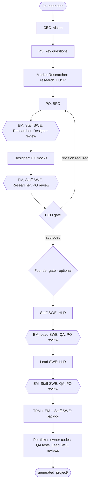

# startup-swarm

[](https://github.com/pankajkumar-codes/startup-swarm/actions/workflows/test.yml)
[](LICENSE)

**Give it a product idea. A team of ten AI agents (CEO, product, research, design, engineering, QA)
turns it into a vision, requirements, designs, a backlog, and working code with tests, with a real
review gate between every step.**

It is an open-source Python tool you run yourself, on your own model account. It is for developers
and founders who want to see what a structured AI team produces from an idea, and who will read and
own the result. It is not a hosted service, and it does not replace engineers: the output is a
first draft for you to review.

## Try it in two minutes (free, offline)

```bash
python3 -m venv .venv && source .venv/bin/activate      # Windows PowerShell: py -3.12 -m venv .venv; .\.venv\Scripts\Activate.ps1
pip install "git+https://github.com/pankajkumar-codes/startup-swarm.git@v0.3.1"
startup-swarm init
startup-swarm run --mock --idea "A CLI that converts CSV files to JSON"
```

This uses the built-in mock model: no account, no cost, placeholder text. It proves the whole
pipeline, gates and resume logic work on your machine. Add a real model with the
[first real run](#your-first-real-run-claude-api) below.

## What you get

```text
artifacts/beta/<project>/
  00_CEO_VISION.md   01_MARKET_RESEARCH.md   01_BRD.md   02_MOCKS.md   02_CEO_DECISION.md
  03_HLD.md          04_LLD.md               05_SPRINT_BACKLOG.md
  reviews/           every reviewer's verdict and the merged punch list
  tickets/           one report per ticket
  generated_project/ the code and tests
  .history/          every version of every document
```

## Why it is different

- **Process rules are code, not prompts.** Engineering cannot start until the CEO gate is approved, and an
  unreadable review counts as a blocker, never as a pass.
- **Cloud-neutral.** Claude API, Amazon Bedrock, Google Vertex AI or Microsoft Foundry (Azure). Pick one in `config.yaml`.
- **Token-frugal and resumable.** Agents hand off documents, not chat history. Reviews are scoped, revisions are bounded,
  prompts are cached, and a hard token budget stops a run cleanly so you can resume it.
- **Pluggable storage.** Local disk by default; cloud packages add hosted storage and deployment.

> **Read before you run it with a real model**
>
> - **It spends real money.** Every real run calls a paid model API. A full run is many calls
>   across all ten roles. `budget_cap_tokens` (default 600,000 tokens per run) is the hard stop, but
>   the tool shows tokens, not dollars. Start with a small cap such as `100000`, run
>   `startup-swarm status` to see usage, and check your provider's billing page.
> - **Mock mode is free and offline**, but it produces placeholder text, not real output.
> - **Generated code is not trusted.** The orchestrator writes files and never runs them. Read the
>   code, run its tests yourself and do not deploy it unreviewed.
> - **Existing repos are protected.** `task --target-dir` refuses to overwrite a file you did not pass
>   with `--context-file`, and never touches `.github/`.
> - **Do not put secrets in your idea or context files.** They are sent to your model provider.
> - **Status of the providers.** `anthropic` and the offline `mock` are the primary paths. `bedrock`,
>   `vertex` and `foundry` are implemented and unit-tested against fakes, but have not been tried
>   against the real services yet. Treat them as experimental and please report what you find.

| Repository | What it is |
|---|---|
| **startup-swarm** (this repo) | The agents, pipeline, CLI and model providers. Use it anywhere. |
| [startup-swarm-aws](https://github.com/pankajkumar-codes/startup-swarm-aws) | AWS hosting: S3 + DynamoDB backend, AgentCore Runtime, CDK, beta/prod deploys. |

## How the company works



| # | Role | Modelled on | Owns | Default tier |
|---|---|---|---|---|
| 1 | CEO | Amazon VP / single-threaded leader | Vision, go/no-go gate | evaluator |
| 2 | Staff Engineering Manager | Meta M2 / Google L7 EM | Feasibility, scoping, staffing | workhorse |
| 3 | Staff Product Owner | Google L6 PM / Amazon Principal PM-T | Research questions, BRD (PR/FAQ, Gherkin) | reasoner |
| 4 | Staff TPM | Amazon Principal TPM | Backlog, dependencies, status | workhorse |
| 5 | Staff Market Researcher | Staff UX research / product marketing | Market position, USP | evaluator |
| 6 | Staff Software Engineer | Google L6 / Meta E6 | HLD, cross-cutting tickets | reasoner |
| 7 | Lead Software Engineer | Amazon L6 tech lead | LLD, contracts, code review | reasoner |
| 8 | Senior Software Engineer | Google L5 / Meta E5 | Implementation | workhorse |
| 9 | Staff QA / SDET | Amazon QAE III / Google L6 SDET | Tests | workhorse |
| 10 | Staff Product Designer | Meta/Apple L6 design technologist | Developer-experience mocks | reasoner |

Tiers map to models in `config.yaml`. By default the reasoner is Claude Sonnet 5.5, and the
workhorse and evaluator are Claude Haiku 5.5. The shared company charter that every agent
follows is in `startup_swarm/agents/charter.py`.

## Quickstart in detail

Requires Python 3.11+.

macOS / Linux:

```bash
python3 -m venv .venv && source .venv/bin/activate
pip install "git+https://github.com/pankajkumar-codes/startup-swarm.git@v0.3.1"

mkdir my-startup && cd my-startup
startup-swarm init                                        # writes config.yaml
startup-swarm run --mock --idea "A CLI that turns meeting notes into Jira tickets"
startup-swarm status --mock
```

Windows (PowerShell):

```powershell
py -3.12 -m venv .venv
.\.venv\Scripts\Activate.ps1                              # if blocked: Set-ExecutionPolicy -Scope Process Bypass
pip install "git+https://github.com/pankajkumar-codes/startup-swarm.git@v0.3.1"

mkdir my-startup; cd my-startup
startup-swarm init
startup-swarm run --mock --idea "A CLI that turns meeting notes into Jira tickets"
startup-swarm status --mock
```

You should see each document reviewed as `APPROVED`, then `COMPLETED: All phases done`.

### Your first real run (Claude API)

```powershell
pip install "startup-swarm[anthropic] @ git+https://github.com/pankajkumar-codes/startup-swarm.git@v0.3.1"
$env:ANTHROPIC_API_KEY = "sk-ant-..."          # macOS/Linux: export ANTHROPIC_API_KEY=...
# In config.yaml set token_controls.budget_cap_tokens to 100000 for a first, cheap test
startup-swarm run --provider anthropic --idea "A CLI that converts CSV files to JSON"
startup-swarm status
```

If the run stops with `PAUSED_BUDGET`, nothing is lost: raise the cap and run again to resume.

Everything is written to `artifacts/beta/<project>/`:

- the numbered documents (vision, research, BRD, mocks, HLD, LLD, backlog)
- `reviews/`
- `tickets/`
- `generated_project/` (code and tests)
- `.history/` (every version and diff)

Mock output is placeholder text. It proves the plumbing, gates and resume logic work, not the
quality of real model output.

## Choose a model provider

Install the extra for your provider, for example
`pip install "startup-swarm[bedrock] @ git+https://github.com/pankajkumar-codes/startup-swarm.git@v0.3.1"`.
Then set `provider.name` in `config.yaml`, or pass `--provider` on each command.

| Provider | Install | Credentials | Model IDs in config |
|---|---|---|---|
| `anthropic` (Claude API) | `startup-swarm[anthropic]` (see install note below) | `ANTHROPIC_API_KEY` | `claude-sonnet-5-5` |
| `bedrock` (AWS) | `startup-swarm[bedrock]` | AWS credential chain (profile, env, role) | `global.anthropic.claude-sonnet-5-5` |
| `vertex` (GCP) | `startup-swarm[vertex]` | `gcloud auth application-default login`; set `provider.project_id` and `provider.region` | `claude-sonnet-5-5` |
| `foundry` (Azure) | `startup-swarm[foundry]` | `AZURE_FOUNDRY_API_KEY`, or Entra ID (`az login`); set `provider.base_url` | your deployment names |
| `mock` | included | none | none |

Run `startup-swarm info` to see which providers and backends are installed. Each provider
names models differently, so every tier lists a model ID per provider:

```yaml
models:
  reasoner:
    model_ids:
      anthropic: "claude-sonnet-5-5"
      bedrock: "global.anthropic.claude-sonnet-5-5"
      vertex: "claude-sonnet-5-5"
      foundry: "claude-sonnet-5-5"     # your Foundry deployment name
```

Check each cloud's model catalog for the exact IDs your account can call, and enable model
access there first. All four providers use the same prompt-caching layout and report real
cache read/write tokens.

## Talking to the team

| You want to | Command |
|---|---|
| Start or continue the full company | `startup-swarm run --idea "..."` (later runs: `startup-swarm run`) |
| Give one task straight to engineering | `startup-swarm task "Add retry with backoff" --context-file src/client.py` |
| See where things stand | `startup-swarm status` (add `--json` for tools and dashboards) |
| Approve or override a gate | `startup-swarm approve-gate founder` / `startup-swarm approve-gate ceo` |
| Work on several products | add `--project <name>` to any command |

Common flags: `--stage`, `--provider`, `--backend`, `--mock`, `--config`, `--workspace`, `-v`.

**`config.yaml` is the founder brief.** It holds the default idea, the reference repo, the
provider, the model per role, the reviewers per document, the gate rules and the token limits.

**Direct task mode** skips the CEO, PO and Designer. The EM scopes the task and may reject it.
The Lead SWE writes a contract, the owner codes, QA writes tests and the Lead SWE reviews,
with one fix pass if needed. Use `--target-dir` to write into an existing repo folder. Paths
are validated, so nothing is written outside it.

## Process rules (enforced in `startup_swarm/pipeline.py`)

- **Phases are checkpointed.** Re-running resumes after the last finished phase, so a crash,
  budget stop or timeout never pays twice for the same work. `run --fresh` restarts a local
  project.
- **Scoped reviews.** Only the roles listed in `process.reviewers` review each document.
  Reviews are strict JSON. Invalid JSON is retried once and then counts as a blocker, so a
  broken review never passes by accident.
- **Bounded revisions.** Blockers are merged into one deduplicated punchlist, and the author
  revises at most `max_review_rounds` times. With `rereview_after_revision: true`, anything
  still blocked is escalated to the CEO in `99_OPEN_ISSUES.md`.
- **CEO gate.** The CEO returns a JSON decision. `REVISION_REQUIRED` sends the required
  changes back to the PO and Designer. After `max_ceo_gate_attempts` the run stops with
  `BLOCKED_ON_CEO_APPROVAL`, and no architecture work starts.
- **Founder gate (optional).** With `founder_approval_required: true`, the run pauses after
  CEO approval until you run `approve-gate founder`.
- **Ticket batches.** Phase 5 builds at most `max_tickets_per_run` tickets per run, in priority
  and dependency order.

## Token controls

| Control | What it does |
|---|---|
| Artifact bus | Agents read documents, not chat history. Each call carries only what it needs. |
| Tiered models | The reasoner tier handles synthesis (BRD, mocks, HLD, LLD). The cheaper tiers handle code, tests, reviews and gates. |
| Prompt caching | The shared charter and the document under review sit in a cached prefix. All reviewers of a document share one model, so the document is cached once and the other reviewers read it from cache. |
| Bounded reviews | Review output is capped by `max_review_output_tokens`, with one revision round by default. |
| Budget cap | `budget_cap_tokens` stops the run cleanly (`PAUSED_BUDGET`). The next run resumes. |
| Measured, not assumed | Real input, output, cache-read and cache-write tokens are reported per run and per agent, in `usage_last_run.json` and in `status`. |

## Storage backends and plugins

The core ships the `local` backend: files plus a `state.json` in the workspace. Other packages
can register more backends and providers through Python entry points, with no change to the core:

```toml
# in a plugin's pyproject.toml
[project.entry-points."startup_swarm.backends"]
aws = "startup_swarm_aws.backend:AWSBackend"

[project.entry-points."startup_swarm.providers"]
my-provider = "my_pkg:make_client"
```

A backend implements `make_state()`, which returns a `StateStore` subclass, and optionally
`make_mirror()`, which returns a `RemoteMirror` with `put`, `pull_all` and `describe`. See
`startup_swarm/backends.py`, and `startup-swarm-aws` for a full example. Select a backend with
`--backend`, `SWARM_BACKEND`, or `stages.<stage>.backend` in `config.yaml`.

## Using parts of it

The agents and clients work without the pipeline:

```python
from startup_swarm import Settings, make_client
from startup_swarm.agents import StaffSWEAgent

settings = Settings.load("config.yaml", "beta", provider="anthropic")
client = make_client(settings)
swe = StaffSWEAgent(settings.model_for_role("staff_swe"), client)
print(swe.author("author:hld", "Write an HLD for a URL shortener."))
print(client.usage.as_dict())
```

## Development

```bash
git clone https://github.com/pankajkumar-codes/startup-swarm.git
cd startup-swarm
python3 -m venv .venv && source .venv/bin/activate
pip install -e ".[dev,all]"

python -m pytest -q                                   # offline tests
black --check startup_swarm tests && flake8 startup_swarm tests
```

Before you push: tests and lint pass, and `git status` shows no `.env*` or `artifacts/` files.

**Branches and releases.** Work on a branch, open a PR into `main`, and CI must pass to merge.
To release, bump `__version__` in `startup_swarm/__init__.py`, merge, then push a matching tag.
The Release workflow builds the package and creates a GitHub release. Cloud repos pin to these tags.

```bash
git tag vX.Y.Z && git push origin vX.Y.Z
```

## Repository layout

```
startup_swarm/
  agents/            ten roles + shared charter
  llm/               providers: anthropic, bedrock, vertex/foundry, mock
  pipeline.py        phases, review cycles, gates, resume
  engineering.py     per-ticket flow: code -> tests -> code review -> fix
  artifact_bus.py    versioned documents + RemoteMirror interface
  state_store.py     phases/gates/usage + StateStore interface
  backends.py        backend registry (local built in, plugins via entry points)
  cli.py, status.py  startup-swarm command and status report
  templates/         document structures for BRD, mocks, HLD, LLD, backlog
  config.example.yaml
tests/               offline unit and integration tests
```

## Limits and safety

- Generated code is written to disk, but the orchestrator never executes it. Read it and run
  its tests yourself before publishing.
- The Market Researcher only knows the reference repo's README and file list (fetched from
  GitHub) plus what the model already knows. It has no live web search, and it is told to list
  unknowns instead of inventing numbers.
- Agents can be wrong. Gates and reviews reduce that, but your review is the final gate.

## Troubleshooting

| Symptom | Fix |
|---|---|
| `Provider needs ...: pip install` | Install that provider's extra, for example `startup-swarm[bedrock]`. |
| `No model id for provider` | Add `models.<tier>.model_ids.<provider>` to `config.yaml`. |
| Access denied / model not found | Enable the model in your cloud's model catalog, or fix the ID or deployment name. |
| Error mentioning `ttl` | Set `cache_ttl: "5m"` (1h is supported only on recent Claude models). |
| `PAUSED_BUDGET` | Raise `budget_cap_tokens` and run again. Finished phases are kept. |
| `BLOCKED_ON_CEO_APPROVAL` | Read `02_CEO_DECISION.md`, edit the BRD or mocks if you like, then re-run or run `approve-gate ceo`. |
| `Unknown backend 'aws'` | `pip install` startup-swarm-aws. |

## Contributing and security

See [CONTRIBUTING.md](CONTRIBUTING.md). Report vulnerabilities privately as described in
[SECURITY.md](SECURITY.md). If you try a real provider, please open a *Run report* issue.

## License

MIT. See `LICENSE`.
